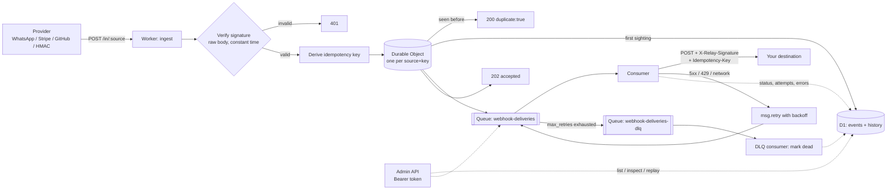

# edge-webhook-relay

[](https://github.com/EliasOlie/edge-webhook-relay/actions/workflows/ci.yml)


A small Cloudflare Worker that sits between webhook providers and your
application. It **verifies signatures** against the raw body (WhatsApp Cloud API,
Stripe, GitHub, or any HMAC-signing provider), **de-duplicates** retries and
concurrent re-sends through a Durable Object, **answers in milliseconds** so
providers never time out, and then **delivers reliably** through Cloudflare
Queues with exponential backoff, a dead-letter queue, a signed outbound request
and an `Idempotency-Key` header. Every event and every delivery attempt is kept
in D1 as an audit trail, with an admin API to inspect and replay. It pairs
naturally with WhatsApp Cloud API bots: Meta expects a fast `200` and
re-sends aggressively, while your bot wants each message exactly once.

## Architecture



Request path, step by step:

1. `POST /in/:source` looks up the source in `SOURCES` and reads the **raw body**
   (size-limited, default 256 KiB).
2. The source's verifier checks the signature over those exact bytes using
   WebCrypto and a constant-time comparison. Failure: `401`, nothing stored.
3. The verifier derives the provider's natural idempotency key (see table
   below), falling back to `sha256:<hex of body>`.
4. The `IdempotencyGuard` Durable Object for `(source, key)` runs `admit()`
   inside `blockConcurrencyWhile`: it writes the event to D1, sends
   `{ eventId }` to the queue, and only then remembers the key.
5. The provider gets `202 {accepted, id}` (first time) or
   `200 {duplicate: true, id}` (every later time). Delivery happens
   asynchronously.
6. The queue consumer loads the payload from D1 and POSTs it to the source's
   destination with a relay signature. 2xx marks it `delivered`; retryable
   failures call `msg.retry({ delaySeconds })`; after `max_retries` the message
   lands in the DLQ and its consumer marks the event `dead`.

## Supported sources

| Type | Signature | Idempotency key | Extra |
| --- | --- | --- | --- |
| `whatsapp` | `X-Hub-Signature-256: sha256=<hex>` HMAC-SHA256 of the raw body with the Meta **app secret** | Sorted set of `msg:<wamid>` and `status:<wamid>:<status>` (so `sent` -> `delivered` -> `read` are distinct events) | `GET` subscription handshake: `hub.mode=subscribe` + `hub.verify_token` -> echoes `hub.challenge` |
| `stripe` | `Stripe-Signature: t=<unix>,v1=<hex>` over `"<t>.<raw body>"`; multiple `v1` accepted (secret rotation) | Event `id` (`evt_...`) | Timestamp tolerance (default 300 s, past and future) |
| `github` | `X-Hub-Signature-256: sha256=<hex>` | `X-GitHub-Delivery` (stable across redeliveries) | |
| `generic` | HMAC-SHA256 of the raw body in a configurable header, optional prefix, hex or base64 | Configurable header, else SHA-256 of body | |

## Guarantees (and what is not guaranteed)

**Guaranteed**

- **No unauthenticated event is stored or delivered.** Missing secrets fail
  closed (`500`), they never disable verification.
- **No event is acknowledged before it is durable.** A `202` means the row is
  in D1 and the message is on the queue. If either write fails, the provider
  gets `503`, the key is *not* marked as seen, and the provider's retry can
  succeed.
- **Duplicates are suppressed race-free.** Concurrent requests with the same
  key are serialized by a single Durable Object instance; exactly one gets
  `202` and is enqueued, the rest get `200 duplicate:true` (this is tested with
  five parallel requests). D1's `UNIQUE(source, idempotency_key)` remains the
  long-term record after the Durable Object's cache TTL (7 days) expires.
- **At-least-once delivery.** Queue messages are retried with exponential
  backoff (10 s, 20 s, 40 s, ... capped at 1 h) and end in a DLQ, never silently
  dropped. Dead events stay in D1 and can be replayed.
- **Effectively-once processing downstream**, *if the destination honours the
  `Idempotency-Key` header*. The key is the relay event id: stable across
  retries, DLQ replays and admin replays of the same event.

**Not guaranteed**

- **Ordering.** Queues do not preserve order, and retries reorder further. Use
  provider timestamps (`created`, `timestamp`) if order matters.
- **Exactly-once delivery on the wire.** A destination can receive the same
  event twice (e.g. it timed out after processing; or the queue send succeeded
  but marking `enqueued_at` failed and the provider retried). That is what
  `Idempotency-Key` is for.
- **De-duplication of keys the provider does not repeat.** If a provider
  re-sends an event with a *different* id, it is a different event. The
  body-hash fallback only catches byte-identical re-sends.
- **Delivery to permanently failing destinations.** A non-retryable `4xx`
  (anything except 408/425/429) marks the event `dead` immediately rather than
  burning retries.

## Quickstart

Prerequisites: [Bun](https://bun.sh) and a Cloudflare account (Workers Paid is
required for Queues).

```sh
bun install
bun run typecheck
bun run test            # runs inside workerd via Miniflare: DO, D1 and Queues are real

# Create the resources (prints ids)
bunx wrangler d1 create webhook-relay           # paste database_id into wrangler.jsonc
bunx wrangler queues create webhook-deliveries
bunx wrangler queues create webhook-deliveries-dlq
bun run db:migrate:remote

# Secrets (one prompt each; never put them in wrangler.jsonc)
bunx wrangler secret put ADMIN_TOKEN
bunx wrangler secret put RELAY_SIGNING_SECRET
bunx wrangler secret put WHATSAPP_APP_SECRET
bunx wrangler secret put WHATSAPP_VERIFY_TOKEN
bunx wrangler secret put STRIPE_WEBHOOK_SECRET
bunx wrangler secret put GITHUB_WEBHOOK_SECRET

bun run deploy
```

Then point each provider at `https://<your-worker>/in/<source>`, e.g.
`/in/whatsapp` as the callback URL in the Meta app dashboard (use the same
verify token you stored in `WHATSAPP_VERIFY_TOKEN`).

For local development: `cp .dev.vars.example .dev.vars`, edit,
`bun run db:migrate:local`, then `bun run dev`.

### Configuration

Sources live in `vars.SOURCES` in [`wrangler.jsonc`](wrangler.jsonc). `secret`
and `verifyToken` hold the **names** of Worker secrets, never their values:

```jsonc
"SOURCES": {
  "whatsapp": {
    "type": "whatsapp",
    "destination": "https://bot.example.com/webhooks/whatsapp",
    "secret": "WHATSAPP_APP_SECRET",
    "verifyToken": "WHATSAPP_VERIFY_TOKEN"
  }
}
```

| Var | Default | Meaning |
| --- | --- | --- |
| `MAX_BODY_BYTES` | `262144` | Larger requests get `413` |
| `DEDUP_TTL_SECONDS` | `604800` | How long a Durable Object keeps its key cached |
| `DELIVERY_TIMEOUT_MS` | `10000` | Per-attempt timeout to the destination |
| `RETRY_BASE_SECONDS` / `RETRY_MAX_SECONDS` | `10` / `3600` | Backoff: `base * 2^(attempt-1)`, capped |
| `DEAD_LETTER_QUEUE` | `webhook-deliveries-dlq` | Lets the queue handler tell the DLQ batch apart |

## Verifying deliveries in your destination

Each delivery carries:

```
Idempotency-Key: <event id>
X-Relay-Event-Id: <event id>
X-Relay-Source: whatsapp
X-Relay-Attempt: 1
X-Relay-Signature: t=<unix seconds>,v1=<hex HMAC-SHA256(RELAY_SIGNING_SECRET, "<t>.<event id>.<body>")>
```

The body is byte-for-byte what the provider sent. Example check (Node/Bun):

```ts
import { createHmac, timingSafeEqual } from "node:crypto";

function verifyRelay(req: { headers: Record<string, string>; rawBody: string }, secret: string) {
  const [, t, v1] = /^t=(\d+),v1=([0-9a-f]{64})$/.exec(req.headers["x-relay-signature"] ?? "") ?? [];
  if (!t || !v1 || Math.abs(Date.now() / 1000 - Number(t)) > 300) return false;
  const expected = createHmac("sha256", secret)
    .update(`${t}.${req.headers["idempotency-key"]}.${req.rawBody}`)
    .digest();
  return timingSafeEqual(expected, Buffer.from(v1, "hex"));
}
// Then: INSERT ... ON CONFLICT (idempotency_key) DO NOTHING before side effects.
```

## Admin API

All admin routes require `Authorization: Bearer $ADMIN_TOKEN` (compared in
constant time). With no `ADMIN_TOKEN` configured, the admin API is disabled.

```sh
RELAY=https://edge-webhook-relay.<account>.workers.dev
AUTH="Authorization: Bearer $ADMIN_TOKEN"

# List (newest first, payload omitted). Filters: status, source. Paging: limit, before.
curl -s -H "$AUTH" "$RELAY/admin/events?status=dead&source=stripe&limit=50"

# One event with payload and its full audit history
curl -s -H "$AUTH" "$RELAY/admin/events/0b6c1e9e-6a55-4a8e-9d7e-2b1d9d7f3c11"

# Replay one event (409 if already delivered; add ?force=true to resend anyway)
curl -s -X POST -H "$AUTH" "$RELAY/admin/events/0b6c1e9e-6a55-4a8e-9d7e-2b1d9d7f3c11/replay"

# Replay the dead-letter backlog (100 per call; "more": true means call again)
curl -s -X POST -H "$AUTH" "$RELAY/admin/dlq/replay"
```

Example `GET /admin/events/:id` response:

```json
{
  "event": {
    "id": "0b6c1e9e-6a55-4a8e-9d7e-2b1d9d7f3c11",
    "source": "stripe",
    "idempotency_key": "evt_1Q2w3E4r5T6y",
    "status": "delivered",
    "attempts": 2,
    "last_error": "http_503",
    "payload_sha256": "9f2c...",
    "payload": "{\"id\":\"evt_1Q2w3E4r5T6y\",...}"
  },
  "history": [
    { "at": 1762862400000, "kind": "received", "detail": { "payload_sha256": "9f2c..." } },
    { "at": 1762862400004, "kind": "enqueued", "detail": null },
    { "at": 1762862400310, "kind": "attempt_failed", "detail": { "attempt": 1, "http_status": 503 } },
    { "at": 1762862410420, "kind": "delivered", "detail": { "attempt": 2, "http_status": 200 } }
  ]
}
```

## Adding a new source

1. Add a config type to [`src/sources/types.ts`](src/sources/types.ts) and to the
   `SourceConfig` union.
2. Implement `SourceVerifier` in `src/sources/<name>.ts`:

   ```ts
   export const acmePay: SourceVerifier<AcmePayConfig> = {
     type: "acmepay",
     async verify(input, config, secret) {
       // input.rawBody: exact bytes received. Never re-serialize JSON for signing.
       // Use hmacSha256 + constantTimeEqual from src/lib/crypto.ts.
       return { ok: true };
     },
     idempotencyKey(input) {
       // The provider's event/delivery id, or null to fall back to the body hash.
       return input.headers.get("x-acmepay-event-id");
     },
     // Optional: handshake(url, config, lookupSecret) for GET verification flows.
   };
   ```

3. Register it in [`src/sources/registry.ts`](src/sources/registry.ts).
4. Add an entry to `SOURCES` and `wrangler secret put` its secret.
5. Add accept/reject tests in `test/verifiers.test.ts` (valid signature, wrong
   secret, tampered body, missing header, replay window if any).

If the provider just signs the body with HMAC-SHA256 in a header, you need no
code: use `"type": "generic"` with `signatureHeader`, `signaturePrefix`,
`encoding` and `idempotencyHeader`.

## Design decisions and trade-offs

- **Durable Object per (source, key), not per shard.** One instance per key
  gives the simplest correct serialization: `blockConcurrencyWhile` makes the
  whole check-persist-enqueue sequence atomic for that key, and unrelated keys
  never queue behind each other. The cost is one tiny object per event, which
  an alarm wipes after `DEDUP_TTL_SECONDS`. A sharded design (N objects, keys
  in storage) would trade contention and a bigger blast radius for fewer
  objects.
- **Why a Durable Object if D1 has a UNIQUE constraint?** The constraint alone
  tells you *that* a row exists, not whether the first request finished its
  enqueue. Without serialization, a concurrent duplicate could be answered
  `200` while the original then fails, and the event would be lost because the
  provider stops retrying. The DO makes the second request wait for the
  first's outcome. D1 is still the durable record (`enqueued_at` marks a
  finished admission), so a half-finished admission is repaired on the next
  retry instead of being treated as a duplicate.
- **Persist before `202`, deliver after.** Writing one D1 row and one queue
  message costs a few milliseconds and makes the acknowledgement honest.
  Everything slow (the destination) is behind the queue.
- **Payload in D1 `TEXT`, not R2.** Webhook bodies are small JSON (WhatsApp and
  GitHub events are typically a few KB; Stripe events well under 1 MB) and the
  ingest limit is 256 KiB, comfortably inside D1's row limit. Keeping the body
  in the same row as its status means one read for delivery and replay, no
  second binding, and no orphaned objects. Bodies must be valid UTF-8 (they
  are stored as text and re-sent byte-identical). If you need large or binary
  payloads, store them in R2 keyed by `payload_sha256` and keep the hash in D1.
- **Queue messages carry only the event id.** Retries, DLQ replays and admin
  replays all send the stored bytes, and message size never limits payloads.
- **Retry policy lives in two places on purpose.** The consumer decides
  *whether* to retry (5xx/408/425/429/network yes, other 4xx no) and *how long*
  to wait; `max_retries` in `wrangler.jsonc` decides *when to give up*, and the
  platform moves the message to the DLQ. Keep them consistent.
- **Outbound signature binds the event id.** The MAC covers
  `t.event_id.body`, so a captured body cannot be replayed under a different
  `Idempotency-Key`, and the timestamp bounds replay of the whole request.
- **No framework.** Routing is a few regexes; the only runtime dependency is
  the Workers runtime itself.
- **Logs are structured JSON with ids, sizes, statuses and reasons only.**
  Signatures, secrets, tokens and payloads are never logged.

## Testing

Tests run inside `workerd` with
[`@cloudflare/vitest-plugin`](https://developers.cloudflare.com/workers/testing/vitest-integration/)
(the successor of `@cloudflare/vitest-pool-workers`), so the Durable Object,
D1 (with the real migration) and the queue producer are the real
implementations. The queue consumer is exercised with `createMessageBatch` and
a mocked destination `fetch`.

Covered: each verifier accept/reject (wrong secret, tampered body, missing or
malformed headers, stale and future Stripe timestamps, secret rotation), the
WhatsApp `hub.challenge` handshake, duplicate suppression (sequential and five
concurrent requests), status transitions as distinct events, body-hash
fallback, size limit, delivery success with signature verification, retry with
backoff on 5xx/429/network, permanent 4xx, DLQ, admin authentication, listing,
inspection and replay.

```sh
bun run test
```

## Project layout

```
src/
  index.ts              routes + queue dispatch
  env.ts                bindings and config types
  http/ingest.ts        POST/GET /in/:source
  http/admin.ts         /admin/* API
  dedup/guard.ts        IdempotencyGuard Durable Object
  delivery/consumer.ts  queue + DLQ consumers
  delivery/backoff.ts   retry delay policy
  delivery/sign.ts      outbound X-Relay-Signature
  sources/              pluggable verifiers (whatsapp, stripe, github, generic)
  store/events.ts       D1 access (events + audit history)
  lib/                  crypto, http helpers, structured logging
migrations/             D1 schema
test/                   vitest suites (run in workerd)
```

## License

[MIT](LICENSE) © 2026 Elias Oliveira
